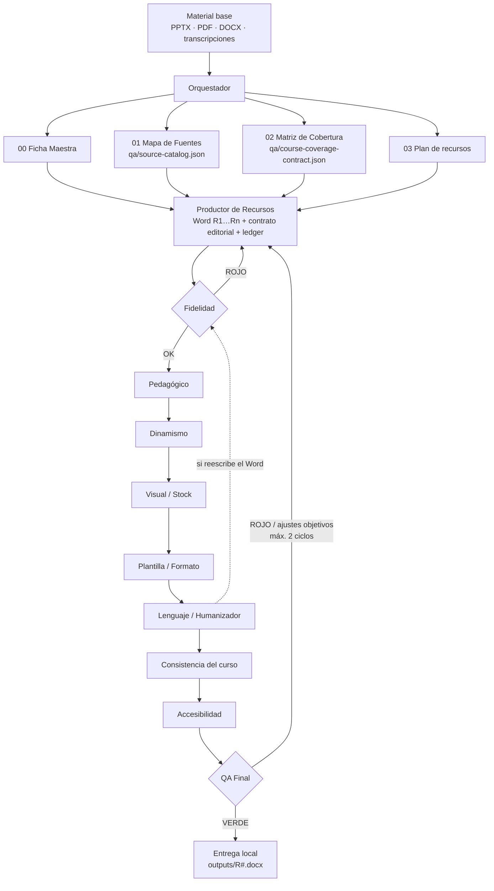

# Course Agent Suite · v1.4.1

**Suite de 11 agentes de IA para diseño instruccional.** Convierte uno o varios materiales base (PPTX, PDF, DOCX, transcripciones) en recursos e-learning listos para edición —guiones de video, lecturas Rise, evaluaciones, infografías, descargables— y los somete a una cadena de revisores especializados hasta un QA final con evidencia verificable.

Funciona con **Claude Code** y con **Codex** (OpenAI). Todo se ejecuta en local: nada se sube a Drive ni a otros servicios salvo petición explícita.

[-2ea44f?style=for-the-badge&logo=github)](https://github.com/Rvilov/Agentes-de-Dise-o-Instruccional/archive/refs/heads/main.zip)


---

## Índice

1. [Descarga](#descarga)
2. [Qué resuelve](#qué-resuelve)
3. [Los 11 agentes](#los-11-agentes)
4. [Flujo de trabajo](#flujo-de-trabajo)
5. [Instalación](#instalación)
6. [Crear un curso nuevo](#crear-un-curso-nuevo)
7. [Producir y revisar un recurso (paso a paso)](#producir-y-revisar-un-recurso-paso-a-paso)
8. [Compuertas de calidad (gates)](#compuertas-de-calidad-gates)
9. [Archivos de evidencia en `qa/`](#archivos-de-evidencia-en-qa)
10. [Contrato del Word entregable](#contrato-del-word-entregable)
11. [Guía normativa Content QA x DI](#guía-normativa-content-qa-x-di)
12. [Referencia de scripts](#referencia-de-scripts)
13. [Estructura del repositorio](#estructura-del-repositorio)
14. [Actualizar una instalación existente](#actualizar-una-instalación-existente)
15. [Pruebas](#pruebas)
16. [Límites conocidos](#límites-conocidos)
17. [Historial de versiones](#historial-de-versiones)

---

## Descarga

| Opción | Enlace |
|---|---|
| **Descargar ZIP (recomendado)** | [Agentes-de-Dise-o-Instruccional-main.zip](https://github.com/Rvilov/Agentes-de-Dise-o-Instruccional/archive/refs/heads/main.zip) |
| Clonar con git | `git clone https://github.com/Rvilov/Agentes-de-Dise-o-Instruccional.git` |

---

## Qué resuelve

Producir cursos con IA tiene tres fallos típicos: el modelo **inventa datos** que no están en el material del cliente, los documentos **no respetan la plantilla** del equipo, y el QA se reduce a un “se ve bien”. Esta suite ataca los tres:

- **Fidelidad comprobable.** Cada afirmación del recurso se registra con su cita literal y su ubicación exacta (diapositiva, página, párrafo, línea) en la fuente. Un script reabre los archivos y verifica que la cita exista, y un revisor independiente juzga si la cita realmente respalda la afirmación.
- **Integridad por versión.** Word y fuentes quedan ligados por SHA-256. Si alguien edita el documento después de aprobarlo (incluso una corrección de estilo), la aprobación queda invalidada automáticamente.
- **Formato determinista.** Las Notas de Edición se generan desde un contrato JSON, no se escriben a mano; auditores verifican orientación A4 vertical, cabecera única, longitud de notas, ubicación de imágenes y ausencia de referencias internas en el Word.
- **Revisión multidimensional.** Pedagogía, dinamismo, visuales/stock, lenguaje, consistencia del curso y accesibilidad tienen cada uno su agente con su rúbrica.
- **Semáforo final con reglas duras.** Un verde posterior nunca anula un rojo de Fidelidad.

---

## Los 11 agentes

Cada agente es una *skill* (carpeta con `SKILL.md`, referencias y scripts) que Claude Code o Codex cargan automáticamente.

| # | Skill | Nombre visible | Rol |
|---|---|---|---|
| 1 | `course-production-orchestrator` | Orquestador de Producción | Recibe el material base, crea Ficha Maestra, Mapa de Fuentes y Matriz de Cobertura, jerarquiza fuentes y prepara el proyecto. |
| 2 | `resource-producer` | Productor de Recursos | Genera cada recurso (R1, R2, …) como Word independiente en la plantilla oficial, con su contrato editorial y su ledger de evidencia. |
| 3 | `source-fidelity-reviewer` | Revisor de Fidelidad | **Gate crítico.** Compara cada afirmación con la fuente: cifras, fechas, nombres, requisitos, excepciones, secuencias. Emite juicio por afirmación y por tema. |
| 4 | `pedagogical-reviewer` | Revisor Pedagógico | Alineación objetivo–contenido–práctica–evaluación, nivel cognitivo, transferencia, carga cognitiva y distribución de respuestas correctas. |
| 5 | `dynamism-reviewer` | Revisor de Dinamismo | Ritmo, proporción texto/interacción, longitud de párrafos y escenas, variedad de bloques (Rise, Storyline, Genially, video). |
| 6 | `visual-stock-reviewer` | Revisor Visual y de Stock | Pertinencia de imágenes y gráficos, búsquedas reales de stock con enlaces clicables, plan visual por panel/escena. |
| 7 | `template-format-reviewer` | Revisor de Plantilla y Formato | Estructura del Word, campos, hipervínculos reales, imágenes en su columna, render visual página por página. |
| 8 | `language-humanizer` | Corrector y Humanizador | Ortografía, gramática, puntuación, tú/usted, naturalidad y eliminación de patrones de texto de IA, sin cambiar hechos. |
| 9 | `course-consistency-reviewer` | Revisor de Consistencia | Revisa todos los recursos juntos: terminología, personajes, ejemplos, tono, continuidad y contradicciones entre R. |
| 10 | `accessibility-reviewer` | Revisor de Accesibilidad | Texto alternativo, subtítulos/transcripción, contraste, dependencia del color, instrucciones claras. No afirma WCAG completo sin el curso implementado. |
| 11 | `final-qa` | QA Final | Integra todos los reportes, reejecuta los gates, decide **aprobado / aprobado con ajustes / regresa a producción** y limita los ciclos de autocorrección a 2. |

---

## Flujo de trabajo



**Orden de gates:** `Fidelidad → Pedagógico → Dinamismo → Visual/Stock → Plantilla/Formato → Lenguaje → Consistencia → Accesibilidad → QA Final`

**Corrección híbrida:** los agentes corrigen solos únicamente errores objetivos y verificables (máximo 2 ciclos por recurso). Narrativa, pedagogía, ambigüedad entre fuentes, contenido externo o cambios de significado se escalan a una persona.

---

## Instalación

### Requisitos

- **Python 3.9+**
- `python-docx` para crear/corregir Word por script:
  ```bash
  python -m pip install -r requirements.txt
  ```
- **LibreOffice** y utilidades PDF (p. ej. `pdftoppm`) si quieres el render visual de páginas que usa el revisor de formato.
- Claude Code o Codex.

### Instalar en un proyecto

Descarga y descomprime el ZIP (se crea la carpeta `Agentes-de-Dise-o-Instruccional-main`), y desde esa carpeta ejecuta:

```bash
# Claude Code
python install_suite.py --platform claude --project-dir "/ruta/a/mi-proyecto"

# Codex
python install_suite.py --platform codex  --project-dir "/ruta/a/mi-proyecto"

# Ver qué se tocaría sin cambiar nada
python install_suite.py --platform claude --project-dir "/ruta/a/mi-proyecto" --dry-run
```

Qué hace el instalador:

| Plataforma | Skills se copian a | Reglas globales se añaden a |
|---|---|---|
| Claude Code | `.claude/skills/` | `CLAUDE.md` |
| Codex | `.agents/skills/` | `AGENTS.md` |

- Copia las referencias, scripts, plantillas y la guía normativa a `.course-agent-suite/shared/` para uso offline.
- Inserta un bloque delimitado por `<!-- COURSE_AGENT_SUITE_START -->` … `<!-- COURSE_AGENT_SUITE_END -->` en `CLAUDE.md`/`AGENTS.md` **sin borrar** tu contenido existente (ver [`global-instructions.fragment.md`](global-instructions.fragment.md)).
- Hace backup de la versión anterior en `.course-agent-suite/backups/<fecha>/`.
- **Nunca** borra `sources/`, `templates/`, `resources/`, `outputs/`, `qa/` ni otras skills.

Después, **cierra y vuelve a abrir la sesión** del agente para que cargue las skills.

### Verificar la instalación

```bash
python .course-agent-suite/shared/scripts/validate_content_qa_source.py --root .course-agent-suite/shared
```

Comprueba la integridad del PPTX normativo (SHA-256), la cobertura de las 97 diapositivas y el registro de 27 controles.

---

## Crear un curso nuevo

El orquestador puede hacerlo por ti, o puedes generar el esqueleto a mano:

```bash
python .claude/skills/course-production-orchestrator/scripts/init_course_project.py \
  --course-name "Mi Curso" --out "/ruta/proyectos" --resource-count 6
# opcional: --template /ruta/mi_plantilla.docx
```

Resultado:

```
Mi Curso/
├── 00_ficha_maestra.md        # objetivos, audiencia, tono, glosario, decisiones
├── 01_mapa_fuentes.md         # fuentes F1…Fn, rol y prioridad
├── 02_matriz_cobertura.md     # temas T1…Tn → recursos que los cubren
├── 03_plan_recursos.md        # R1…Rn: tipo, formato, duración
├── sources/                   # material base del cliente (fuente de verdad)
├── templates/resource_template.docx
├── resources/                 # borradores
├── outputs/                   # Word finales
└── qa/                        # toda la evidencia y reportes
    ├── source-catalog.json
    ├── course-coverage-contract.json
    └── course-resource-index.json
```

Luego, en Claude Code o Codex, basta con pedirlo en lenguaje natural, por ejemplo:

> “Usa el orquestador de producción de cursos. El material base está en `sources/`. El curso tiene 6 recursos: R1 Video Plus, R2 Lectura Rise, R3 Infografía, R4 Evaluación… Arma la Ficha Maestra y la Matriz de Cobertura.”

> “Produce R2 con el resource-producer y pásalo por toda la cadena de revisión hasta QA final.”

---

## Producir y revisar un recurso (paso a paso)

Rutas de ejemplo para Claude Code. En Codex cambia `.claude/skills/` por `.agents/skills/`. Los scripts compartidos están siempre en `.course-agent-suite/shared/scripts/`.

**1. Contrato editorial y registro de stock** (obligatorios aunque no haya stock):

- `qa/R1.editorial-contract.json`: filas/escenas en orden, cada una con título numerado, tipo + formato, una acción concreta y `stock_decision`.
- `qa/R1.stock-search-log.json`: búsquedas reales en Magnific/Envato/Freepik o catálogo autorizado, con candidatos y colocación. Si no aplica stock: motivo y `searches: []`.

Plantillas en [`shared/templates/`](shared/templates/).

**2. Generar las Notas de Edición desde el contrato** (nunca a mano):

```bash
python .course-agent-suite/shared/scripts/editorial_contract.py apply \
  --contract qa/R1.editorial-contract.json \
  --docx resources/R1_borrador.docx --output outputs/R1.docx
```

**3. Preparar el ledger de fidelidad:**

```bash
python .course-agent-suite/shared/scripts/fidelity_gate.py prepare \
  --project-dir . --resource-id R1 --docx outputs/R1.docx
```

Enumera todas las unidades de texto de la columna *Contenido del Recurso* con estado `PENDIENTE`. El productor completa afirmaciones, citas literales y ubicaciones; **no puede autoaprobarse**.

**4. Revisión semántica independiente:** el `source-fidelity-reviewer` escribe `qa/R1.fidelity-review.json` con `claim_assessments` y `topic_assessments` (juicio individual por afirmación y por tema).

**5. Gates automáticos:**

```bash
# Fidelidad estricta
python .course-agent-suite/shared/scripts/fidelity_gate.py audit \
  --project-dir . --resource-id R1 --docx outputs/R1.docx \
  --report qa/R1.fidelity-preflight.json --strict

# Todos los gates de preentrega en un solo comando
python .course-agent-suite/shared/scripts/run_quality_gates.py \
  --project-dir . --resource-id R1 --docx outputs/R1.docx --report qa/R1.preflight.json
```

**6. Revisores de calidad:** pedagógico, dinamismo, visual/stock, formato (con render de cada página), lenguaje, accesibilidad. Cada uno entrega su reporte en `qa/`.

**7. QA Final:**

```bash
python .claude/skills/final-qa/scripts/aggregate_reports.py \
  qa/R1.*.report.json \
  --project-dir . --resource-id R1 --docx outputs/R1.docx --out qa/R1.final-qa.json
```

Recibe como argumentos posicionales los reportes JSON de todos los revisores. Con `--partial-review` emite un diagnóstico parcial, que nunca cuenta como verde integral.

Reabre Word y fuentes, repite el gate de fidelidad, exige el reporte del revisor de fidelidad y la cobertura de los 27 controles. Si el resultado es ROJO, el script termina con código de salida distinto de cero.

**8. Curso completo** (cuando todos los R están producidos):

```bash
python .course-agent-suite/shared/scripts/audit_course_coverage.py \
  --project-dir . --report qa/course-fidelity-preflight.json --strict
```

Más una pasada del `course-consistency-reviewer` sobre todos los Word.

---

## Compuertas de calidad (gates)

`run_quality_gates.py` ejecuta seis gates de preentrega. Los seis deben estar en verde, más la revisión humana del render, para declarar un recurso **listo para edición**.

| Gate | Qué comprueba | Falla cuando… |
|---|---|---|
| `notes_canonical` | Las Notas de Edición del Word coinciden literalmente con el contrato JSON. | Alguien editó notas a mano o el Word no se regeneró. |
| `stock_execution` | Cada bloque que eligió stock tiene una búsqueda real registrada y el asset/enlace colocado. | Stock requerido sin búsqueda; `PENDIENTE_STOCK` sin evidencia. |
| `factual_fidelity` | Hashes, citas en ubicación real, clasificación de todas las unidades, temas obligatorios y revisión independiente. | Ledger o revisión incompletos, cita inexistente, Word/fuente modificados. |
| `editorial_length` | Notas de 20–45 palabras (máximo 60) por bloque, sin razonamiento interno ni QA. | `NOTES_EXCESSIVE_ALL_RESOURCES`, `NOTES_INTERNAL_QA`, `IMAGE_IN_EDITORIAL_NOTES`… |
| `document_structure` | A4 vertical, cabecera única, sin `w:tblHeader`, sin fugas de fuentes, trazabilidad externa presente. | Orientación horizontal, cabecera repetida, “Fuente:” dentro del Word. |
| `visual_plan` | Decisión visual por panel (Tabs/Accordion de Rise) y por escena de video, con enlaces reales de stock-video. | Paneles sin propuesta ni excepción razonada; clip sugerido sin URL. |

**Reglas de bloqueo absoluto (ROJO en QA integral):**

- Falta `source-catalog.json`, `course-coverage-contract.json`, `R#.fidelity-ledger.json` o `R#.fidelity-review.json`.
- SHA-256 del Word o de una fuente distinto al registrado.
- Afirmación sin respaldo, cita inexistente o en ubicación incorrecta.
- Una guía de estilo o un catálogo de stock usado como si fuera fuente factual.
- Tema obligatorio sin cubrir.
- PPT normativa ausente (`CONTENT_QA_SOURCE_INCOMPLETE`) o controles sin evidenciar (`CONTENT_QA_COVERAGE_INCOMPLETE`).

**Estados especiales:** búsqueda de stock bloqueada o sin resultados → *implementación pendiente*, nunca “listo para edición”. Stock-video sin URL → `PENDIENTE_STOCK_VIDEO` registrado solo en `qa/`.

---

## Archivos de evidencia en `qa/`

Toda la trazabilidad vive fuera del Word.

| Archivo | Alcance | Contenido |
|---|---|---|
| `source-catalog.json` | Curso | Fuentes aprobadas: ID, ruta, rol, prioridad, `factual: true/false`, SHA-256. |
| `course-coverage-contract.json` | Curso | Temas T#, origen, obligatoriedad y recursos asignados. |
| `course-resource-index.json` | Curso | Lista de recursos registrados para la auditoría de cobertura. |
| `R#.editorial-contract.json` | Recurso | Filas/escenas, notas de edición y `stock_decision` por bloque. |
| `R#.stock-search-log.json` | Recurso | Herramienta, consultas, candidatos, selección, licencia/atribución. |
| `R#.fidelity-ledger.json` | Recurso | Cada unidad de contenido → afirmaciones → citas literales con `slide`/`page`/`paragraph`/`line`. |
| `R#.fidelity-review.json` | Recurso | Juicio independiente por afirmación y por tema. |
| `R#_trazabilidad.md` | Recurso | Trazabilidad legible para humanos. |
| `R#.preflight.json`, `R#.fidelity-preflight.json` | Recurso | Salida de los gates automáticos. |

Ejemplos completos en [`shared/templates/`](shared/templates/).

---

## Contrato del Word entregable

Cada recurso es un `.docx` independiente basado en la plantilla oficial:

- **A4 vertical** (salvo otra orientación aprobada expresamente).
- **Una sola cabecera de metadatos** al inicio; nunca se repite en saltos de página.
- Dos columnas:
  - **Notas de Edición** (izquierda): instrucciones breves de montaje. 20–45 palabras recomendadas, 60 máximo. Sin imágenes, sin razonamiento pedagógico, sin fuentes, sin QA. En video se permiten cues de tiempo útiles y **enlaces reales clicables** a clips de stock.
  - **Contenido del Recurso** (derecha): narración, textos, reactivos e **imágenes reales** insertadas.
- **Prohibido** dentro del Word: `Fuente:`, `Material base:`, `Slides de referencia:`, IDs, ubicaciones o hallazgos de QA.

Política visual: no hay cuota de stock. Cada bloque elige lo que aporta didácticamente (foto, diagrama, mapa mental, pirámide, timeline, interfaz, talento, pleca, pop-up, big caption, B-roll…) y lo justifica. Detalles en [`shared/references/word-delivery-contract.md`](shared/references/word-delivery-contract.md) y [`shared/references/visual-language-and-stock-policy.md`](shared/references/visual-language-and-stock-policy.md).

---

## Guía normativa Content QA x DI

La suite incluye la presentación completa **`Content - Revisión QA x DI.pptx`** (97 diapositivas) como fuente normativa canónica del equipo para redacción y QA:

| Archivo | Uso |
|---|---|
| `shared/source-guides/Content - Revisión QA x DI.pptx` | Fuente original (SHA-256 verificado). |
| `shared/references/content-qa-policy.md` | Cómo aplicar la guía. |
| `shared/references/content-qa-full-slide-index.md` | Texto de las 97 diapositivas. |
| `shared/references/content-qa-control-register.json` | 27 controles, cada uno trazado a su diapositiva y asignado a agentes. |
| `shared/references/content-qa-guidelines.md` | Resumen de navegación (no sustituye a la PPT). |
| `shared/references/general-spanish-supplement.md` | Suplemento de español separado de la guía (p. ej. punto y coma). |

Cubre uniformidad de guiones, arquitectura de bloques, patrones de IA, evaluación equilibrada, sincronía visual, integridad gramatical entre pantallas, puntuación y tú/usted.

---

## Referencia de scripts

### Compartidos (`shared/scripts/`)

| Script | Función |
|---|---|
| `fidelity_gate.py prepare` / `audit` | Crea y audita el ledger de evidencia factual por recurso. |
| `audit_course_coverage.py` | Verifica temas obligatorios en todos los recursos del curso. |
| `run_quality_gates.py` | Ejecuta los 6 gates de preentrega y escribe un reporte JSON. |
| `editorial_contract.py apply` | Genera las Notas de Edición en el Word desde el contrato JSON. |
| `audit_stock_execution.py` | Valida que las búsquedas de stock fueron reales y se colocaron. |
| `validate_content_qa_source.py` | Comprueba PPTX normativo, índice y registro de controles. |

### Por skill

| Skill | Script | Función |
|---|---|---|
| course-production-orchestrator | `init_course_project.py` | Crea el esqueleto del curso. |
| | `validate_course_intake.py` | Verifica fuentes locales, existencia y citas por ubicación. |
| | `install.py` | Instalador interno de la skill. |
| resource-producer | `prepare_resource.py` | Prepara Word en vertical y sidecars en `qa/`. |
| | `normalize_resource_docx.py` | Corrige orientación, anchos y cabeceras repetidas de Word antiguos. |
| source-fidelity-reviewer | `extract_office_text.py` | Extrae texto de DOCX/PPTX con ubicaciones. |
| pedagogical-reviewer | `audit_answer_distribution.py` | Detecta patrones previsibles en letras de respuestas correctas. |
| template-format-reviewer | `audit_docx_structure.py` | Orientación, cabecera, fugas de fuente, trazabilidad. |
| | `audit_editorial_notes.py` | Longitud y contenido de notas en todos los recursos. |
| | `audit_rise_editorial.py` | Reglas adicionales para Rise. |
| | `render_docx.py` | Renderiza el Word a imágenes para inspección visual. |
| visual-stock-reviewer | `audit_visual_plan.py` | Plan visual por panel/escena. |
| | `audit_docx_assets.py` | Imágenes y enlaces realmente presentes en el Word. |
| accessibility-reviewer | `audit_docx_accessibility.py` | Alt text y otros requisitos en el Word. |
| final-qa | `aggregate_reports.py` | Integra reportes, reejecuta gates y emite el semáforo final. |

### Corregir un Word creado con una versión anterior

```bash
python .claude/skills/resource-producer/scripts/normalize_resource_docx.py \
  outputs/R1_Anterior.docx --output outputs/R1_Corregido.docx --orientation portrait

# Mover "Fuente:", "Material base:", "Slides de referencia:" a qa/R1_trazabilidad.md

python .claude/skills/template-format-reviewer/scripts/audit_docx_structure.py \
  outputs/R1_Corregido.docx --orientation portrait \
  --traceability qa/R1_trazabilidad.md --strict
```

---

## Estructura del repositorio

```
course-agent-suite/
├── install_suite.py                  # instalador/actualizador (Claude Code y Codex)
├── global-instructions.fragment.md   # bloque que se inserta en CLAUDE.md / AGENTS.md
├── suite-manifest.json               # metadatos y políticas de la suite
├── requirements.txt
├── CHANGELOG.md
├── QA_REPORT.md                      # pruebas ejecutadas y límites
├── docs/
│   └── README-tecnico.md             # notas técnicas originales por versión
├── shared/
│   ├── references/                   # políticas transversales y guía normativa
│   ├── scripts/                      # gates compartidos
│   ├── templates/                    # ejemplos de JSON de evidencia
│   └── source-guides/                # PPT Content QA x DI (97 diapositivas)
├── skills/
│   ├── course-production-orchestrator/
│   ├── resource-producer/
│   ├── source-fidelity-reviewer/
│   ├── pedagogical-reviewer/
│   ├── dynamism-reviewer/
│   ├── visual-stock-reviewer/
│   ├── template-format-reviewer/
│   ├── language-humanizer/
│   ├── course-consistency-reviewer/
│   ├── accessibility-reviewer/
│   └── final-qa/
│       ├── SKILL.md                  # instrucciones del agente
│       ├── agents/openai.yaml        # nombre y descripción para Codex
│       ├── references/               # rúbricas y contratos de revisión
│       ├── scripts/                  # auditores deterministas
│       └── assets/                   # plantilla Word (cuando aplica)
└── tests/                            # 37 pruebas unitarias
```

---

## Actualizar una instalación existente

1. Descarga la versión nueva y descomprímela **en una carpeta distinta** de la anterior.
2. Ejecuta el instalador apuntando al **mismo** directorio de proyecto:
   ```bash
   python install_suite.py --platform claude --project-dir "/ruta/a/mi-proyecto"
   ```
3. Reinicia la sesión del agente.

Las 11 skills y `.course-agent-suite/shared/` se actualizan en sitio, con backup previo. Si personalizaste archivos **dentro** de las skills, compáralos con el backup porque se sobrescriben.

Una actualización **no reescribe Word anteriores**. Para migrar un curso existente sin rehacer el contenido: registra fuentes y temas en los JSON de `qa/`, ejecuta `fidelity_gate.py prepare` por recurso, completa el ledger, pide la revisión independiente y vuelve a pasar los gates.

---

## Pruebas

```bash
python -m pip install pytest python-docx
python -m pytest -q tests
# 37 passed
```

- 13 pruebas de v1.4.0: notas canónicas y ejecución de stock.
- 24 pruebas de v1.4.1: claim sin fuente, cita inventada, cita en ubicación incorrecta, fuente alterada, Word alterado, tema omitido, revisión genérica “verde”, reporte ausente, archivo no registrado, guía usada como hecho, locators TXT/DOCX/PPTX, auditoría de curso, intake incompleto y bloqueo de QA Final.

Detalle completo en [`QA_REPORT.md`](QA_REPORT.md).

---

## Límites conocidos

- Las comprobaciones literales y por hash acreditan **existencia de la cita e integridad de versión**, no que la cita implique semánticamente la afirmación. Eso lo decide el revisor de fidelidad (agente o persona).
- Los scripts no descubren por sí solos todos los temas obligatorios de una fuente: la Matriz de Cobertura debe construirse con criterio. La auditoría verifica todos los temas **registrados**.
- PDF escaneados, texto en imagen y video/audio sin transcripción requieren inspección manual o una transcripción aprobada. La suite no usa OCR ni conocimiento general como sustituto silencioso.
- La validación real de stock y licencias depende de los conectores/proveedores disponibles en tu entorno.
- Las pruebas usan material sintético; valida la suite con un curso real antes de confiar en ella para producción.

---

## Historial de versiones

| Versión | Cambio principal |
|---|---|
| **1.4.1** | Gate de evidencia factual por afirmación, integridad SHA-256, auditoría de cobertura del curso y bloqueo de QA integral sin revisión independiente. |
| 1.4.0 | Contrato editorial JSON único por recurso y registro obligatorio de búsquedas reales de stock. |
| 1.3.3 | Notas de Edición concisas (20–45 / máx. 60 palabras) en todos los tipos de recurso. |
| 1.3.2 | Rise editorial compacto, imágenes en la columna de contenido. |
| 1.3.1 | Lenguaje visual para Rise y video, instalador con actualización segura y backups. |
| 1.3.0 | Word A4 vertical, cabecera única y trazabilidad fuera del Word. |
| 1.2.0 | PPT de 97 diapositivas como norma canónica, 27 controles trazados. |
| 1.1.0 | Incorporación de la guía Content QA x DI. |

Ver [`CHANGELOG.md`](CHANGELOG.md).

---

**Autor:** Ricardo Vilov ([@Rvilov](https://github.com/Rvilov))
